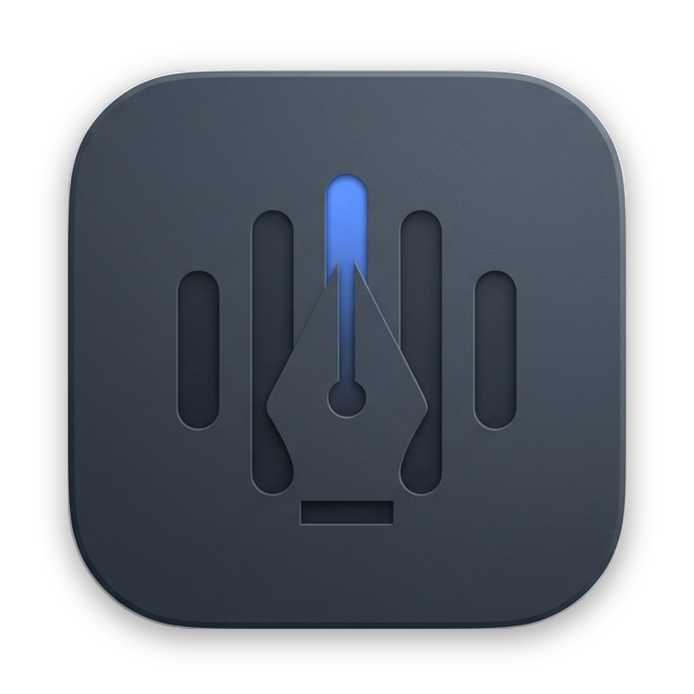

<p align="center">
  
</p>

<h1 align="center">Sonotype</h1>

<p align="center">
  <strong>Ultra-fast, 100% on-device voice dictation for macOS.</strong><br />
  Speak naturally in Portuguese or English. Zero cloud. Zero subscriptions. Zero audio stored on disk.
</p>

<p align="center">
  <a href="#-features"></a>
  <a href="#-technical-stack"></a>
  <a href="#-zero-audio-retention--privacy"></a>
  <a href="#-getting-started"></a>
  <a href="#-license"></a>
</p>

---

> [!NOTE]
> **🇵🇹 Nota em Português**: O Sonotype é uma aplicação nativa e minimalista para macOS que transcreve a sua voz em tempo real diretamente para o cursor de qualquer aplicação ativa, sem recorrer à cloud e sem guardar ficheiros de áudio. O projeto encontra-se em **desenvolvimento ativo (Beta)**. As instruções completas de compilação, utilização e arquitetura estão documentadas abaixo.

---

## ⚡ What is Sonotype?

**Sonotype** is a native macOS productivity tool designed to bridge the gap between spontaneous thought and written text. With a single keystroke, you can dictate thoughts, code comments, emails, or chat messages in **Portuguese** or **English**, and have them injected cleanly at your cursor in any active app (Xcode, Slack, VS Code, Notes, Safari, Terminal, and more).

Unlike cloud-based subscription dictation apps, Sonotype is built on Apple's native speech recognition framework (`SFSpeechRecognizer` with on-device mode enforced). Your audio streams exclusively into volatile RAM, gets transcribed locally on Apple Silicon / Intel hardware, and the audio buffer is wiped immediately.

### Why Sonotype?

- 🔒 **Absolute Privacy (Zero Audio Retention)**: No servers, no APIs, no tracking, and 0 bytes of audio ever written to your disk.
- ⚡ **Near-Instant Cursor Injection**: Directly pastes into the currently focused text field via macOS Accessibility (`AXUIElement`) with keystroke emulation fallbacks.
- 🪟 **True Native macOS Feel**: Designed according to the Apple Human Interface Guidelines (HIG). Liquid glass translucent HUD (`.regularMaterial`), sensory feedback, dynamic Dock visibility, and a clean SwiftUI dashboard.
- 🌐 **First-Class Bilingual Support**: Native detection and smooth switching between Portuguese (`pt-PT`, `pt-BR`) and English (`en-US`, `en-GB`), with seamless support for English tech terms ("Pull Request", "pipeline", "deploy", "merge") during Portuguese dictation.
- 🧼 **Intelligent Post-Processing**: Automatically strips filler words (*"hum"*, *"tipo"*, *"uh"*, *"like"*), balances sentence punctuation, formats line breaks from spoken commands, and enforces proper capitalization.

---

## 🚀 Current Status

| Component | Status | Details |
| :--- | :---: | :--- |
| **Audio Capture & Recognition** | ✅ Ready | Native `AVAudioEngine` + `SFSpeechRecognizer` on-device engine |
| **NLP Post-Processing** | ✅ Ready | Filler removal, oral punctuation, capitalization, bilingual terms |
| **Global Hotkey & State Machine** | ✅ Ready | `⌥ Option + Space` toggle or push-to-talk with silence timeout |
| **Glow-Pulse HUD** | ✅ Ready | Central floating pill with voice amplitude reactive glow |
| **Text Injection** | ✅ Ready | Accessibility API injection with clipboard preservation |
| **Persistence & History** | ✅ Ready | Local SwiftData storage with search and `.txt`/`.md`/`.csv` export |
| **Dashboard & Vocabulary** | ✅ Ready | Custom vocabulary glossary, expansion snippets, and analytics |
| **Menu Bar & Dynamic Dock** | ✅ Ready | Menu bar popover with dynamic dock promotion while windows are open |
| **Onboarding Experience** | ✅ Ready | 3-step setup with interactive dictation sandbox |
| **Distribution / Packaging** | 🔨 Beta | Self-contained signed `.app` and `.dmg` builds available |

---

## 🛠️ System Requirements

- **Operating System**: macOS 14.0 (Sonoma) or macOS 15.0+ (Sequoia)
- **Architecture**: Apple Silicon (M1/M2/M3/M4) or Intel x86_64
- **Required macOS Permissions**:
  - 🎙️ **Microphone**: For live voice input via `AVAudioEngine`.
  - 🛡️ **Accessibility**: For global shortcut listener (`CGEventTap`) and direct cursor text injection (`AXUIElement`).
  - 🗣️ **Speech Recognition**: For Apple's on-device neural language models.

---

## 📦 Installation & Getting Started

### 1. Prerequisites

Make sure you have Xcode 16+ or the Swift 6 Command Line Tools installed:

```bash
swift --version
# Swift version 6.0+ (or Xcode 16+)
```

### 2. Clone the Repository

```bash
git clone https://github.com/simaosousa/Sonotype.git
cd Sonotype
```

### 3. Build & Run Locally

Sonotype includes a convenient `Makefile` to handle building, code signing, and packaging:

```bash
# 1. Compile in release mode
make build

# 2. Package and self-sign local Sonotype.app inside ./build
make local

# 3. Launch Sonotype immediately
make run
```

### 4. Create a Distributable Disk Image (.dmg)

To build a standalone drag-and-drop installer:

```bash
make dmg
```

This creates a verified disk image at `build/Sonotype.dmg`. Double-click the DMG and drag **Sonotype.app** to your `/Applications` folder.

---

## 🎯 How to Use

### Daily Workflow

1. **Activate Dictation**: Press `⌥ Option + Space` (Option + Space) anywhere in macOS.
2. **Speak**: The floating pill appears at the bottom of your screen with an ambient glow pulse reflecting your voice. Speak freely while reading documentation, switching tabs, or inspecting code.
3. **Finish & Insert**: Press `⌥ Option + Space` again. The audio finishes, post-processing cleans the text, and Sonotype injects it directly into your active text field.
4. **Cancel Anytime**: Press `Esc` (Escape) or click the close icon on the HUD to discard the current session without inserting any text.

> [!TIP]
> **Safety Silence Timeout**: If you forget to close a recording session, Sonotype will automatically commit and insert after 45 seconds of continuous silence (configurable in Settings to 15s, 30s, 45s, 60s, or Off).

---

## 🗣️ Spoken Punctuation & Formatting Commands

Sonotype natively listens for spoken punctuation and formatting triggers:

| Command (Português) | Command (English) | Result |
| :--- | :--- | :---: |
| `"vírgula"` | `"comma"` | `,` |
| `"ponto"` / `"ponto final"` | `"period"` / `"full stop"` | `.` |
| `"ponto de interrogação"` | `"question mark"` | `?` |
| `"ponto de exclamação"` | `"exclamation mark"` / `"point"` | `!` |
| `"dois pontos"` | `"colon"` | `:` |
| `"nova linha"` | `"new line"` | `\n` (break) |
| `"novo parágrafo"` | `"new paragraph"` | `\n\n` (paragraph) |

### Automatic Hesitation Removal

Filler words and vocal pauses are automatically stripped out before text is inserted:
- **Português**: `"hum"`, `"ãh"`, `"hã"`, `"éé"`, `"tipo"`, `"ou seja"`
- **English**: `"um"`, `"uh"`, `"er"`, `"like"`

*(Can be disabled in Settings if verbatim literal dictation is preferred).*

---

## 🖥️ Application Architecture

```
┌─────────────────────────────────────────────────────────────┐
│                       macOS Microphone                      │
└──────────────────────────────┬──────────────────────────────┘
                               │ AVAudioEngine (RAM only)
                               ▼
┌─────────────────────────────────────────────────────────────┐
│                 SpeechRecognitionService                    │
│           (Apple Speech: SFSpeechRecognizer)                │
│            • requiresOnDeviceRecognition = true             │
│            • Zero disk retention / Wiped on commit          │
└──────────────────────────────┬──────────────────────────────┘
                               │ Raw Transcripts
                               ▼
┌─────────────────────────────────────────────────────────────┐
│                     TextPostProcessor                       │
│            • Oral Punctuation & Spoken Formatting           │
│            • Filler Words Filter (PT & EN)                  │
│            • Vocabulary Prioritization & Replacements       │
│            • Sentence Capitalization & Grammar Cleanup      │
└──────────────────────────────┬──────────────────────────────┘
                               │ Clean Formatted Text
                               ▼
┌─────────────────────────────────────────────────────────────┐
│                    TextInjectionService                     │
│            1. AXUIElement (Accessibility API direct insert) │
│            2. CGEvent Keystroke Simulation (fallback)       │
│            3. Preserves previous clipboard optionally       │
└──────────────────────────────┬──────────────────────────────┘
                               │
                               ▼
┌─────────────────────────────────────────────────────────────┐
│                 SwiftData Persistence Layer                 │
│            • Text metadata, timestamp & word count only     │
│            • Export to .txt, .markdown, .csv                │
└─────────────────────────────────────────────────────────────┘
```

---

## 🎛️ Settings & Customization

Open the Dashboard or Settings panel from the Menu Bar icon to customize:

- **Hotkey & Mode**: Toggle (Hands-Free) vs. Push-to-Talk; custom hotkey recorder.
- **HUD Appearance**: Ambient waveform only, live preview in the pill, or direct typing stream.
- **Languages**: Auto-detect between Portuguese and English, or lock to a preferred language.
- **Clipboard Management**: Automatically sync to clipboard or preserve pre-existing clipboard contents.
- **Dock Visibility**:
  - *Dynamic (Default)*: Hidden from Dock in background, appears in Dock when windows are open.
  - *Menu Bar Only*: Runs exclusively as a menu bar accessory.
  - *Always in Dock*: Standard macOS application visibility.
- **Custom Vocabulary**: Add technical acronyms, proper nouns, and voice snippets (e.g. *"my email"* ➔ *"user@example.com"*).

---

## 🧪 Testing & Verification

Sonotype includes an extensive automated test suite covering all modules:

```bash
# Run all unit and integration tests
make check
```

Or run via Swift CLI:

```bash
swift test
```

The test suite covers:
- Audio capture and buffer lifecycle
- On-device speech recognition invariants
- Post-processor regexes and oral punctuation
- Hotkey state machine transitions and silence timeouts
- Accessibility cursor injection & clipboard restoration
- SwiftData models, vocabulary operations, and export formats
- Apple HIG contrast ratios and UI view instantiations

---

## 🗺️ Roadmap & Upcoming (v2.0)

- [ ] **Voice Snippets & Prompt Macros**: Expand long multi-line prompt templates with custom vocal triggers.
- [ ] **Custom Hotkeys per Language**: Dedicated shortcuts for forcing Portuguese or English transcription.
- [ ] **Menu Bar Mini-Visualizer**: Optional real-time audio waveform right in the macOS menu bar.
- [ ] **Global Soundpacks**: Additional subtle sensory feedback chimes.

---

## 📄 License

This project is licensed under the [MIT License](LICENSE) — see the LICENSE file for details.

---

<p align="center">
  Crafted with care for macOS using <strong>Swift 6</strong> and <strong>SwiftUI</strong>.
</p>
