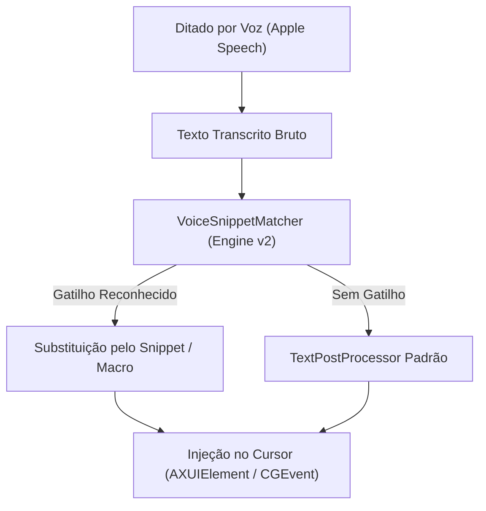

# Especificação de Funcionalidade (v2 Roadmap)
# Voice Snippets & Prompt Macros (Expansão de Texto por Gatilhos de Voz)

> **Estado**: Planeado para a Versão 2.0 (v2)  
> **Data de Registo**: 08 de Outubro de 2026  
> **Autor da Ideia**: Utilizador  
> **Área**: Pós-Processamento de Texto, Produtividade & Dashboard

---

## 1. Visão Geral & Proposta de Valor

A funcionalidade **Voice Snippets & Prompt Macros** permite ao utilizador associar frases de ativação faladas (*Voice Triggers*) a blocos de texto ou prompts pré-definidos (*Snippets/Templates*). Quando o utilizador aciona o Sonotype e dita o gatilho, a aplicação injeta automaticamente o texto completo configurado no cursor da aplicação ativa (IDE, terminal, browser, cliente de email, etc.).

### Exemplo de Uso Real
- **Gatilho Falado**: *"prompt próxima tarefa"*
- **Texto Inserido Automaticamente**:
  ```markdown
  Analisa o estado atual do repositório, identifica a próxima tarefa do roadmap em `docs/roadmap/tasks.md` e prepara o plano de execução seguindo os padrões do projeto.
  ```

### Por que é uma excelente funcionalidade?
1. **Multiplicador de Produtividade**: Transforma o Sonotype de um simples transcritor de voz numa ferramenta ativa de automação (equivalente por voz ao Raycast Snippets, Alfred ou TextExpander).
2. **Ideal para fluxos com IA e Programação**: Permite disparar prompts complexos de arquitetura, templates de commit, mensagens de revisão de código e comandos repetitivos com 2 a 3 palavras faladas.
3. **Privacidade e Offline Total**: As regras e os textos residem 100% localmente na base de dados SwiftData do utilizador, sem qualquer dependência de serviços externos.

---

## 2. Refinamentos & Ajustes Recomendados à Ideia Original

Para garantir máxima fiabilidade e usabilidade no ecossistema macOS, a funcionalidade deve contemplar:

1. **Normalização Fonética e de Texto**:
   - Tratamento de variações de pontuação, minúsculas/maiúsculas e diacríticos (ex: *"próxima tarefa"* vs *"proxima tarefa"* vs *"próxima tarefa."*).
2. **Dois Modos de Correspondência (*Match Modes*)**:
   - **Comando Estrito (*Exact/Solo Trigger*)**: A gravação contém unicamente a frase de ativação (ideal para snippets e prompts longos).
   - **Expansão em Linha (*Inline Expansion*)**: O utilizador fala uma frase normal e o gatilho dentro dela é substituído (ex: *"Envia para o meu email corporativo por favor"* -> *"Envia para joao@empresa.com por favor"*).
3. **Suporte a Texto Multi-linha e Markdown**:
   - Capacidade de colar textos longos com quebras de linha e blocos de código formatados sem corrupção de caracteres.
4. **Variáveis Dinâmicas (Opcional na v2.1)**:
   - Suporte a tags dinâmicas como `{clipboard}` (conteúdo atual da área de transferência), `{date}` (data de hoje) ou `{time}` (hora atual).
5. **Feedback HUD Suave**:
   - Na pílula flutuante (HUD), quando um snippet é ativado, apresentar um feedback subtil como: `Snippet: Prompt Próxima Tarefa ⚡`.

---

## 3. Arquitetura Técnica & Impacto no Sonotype

A arquitetura do Sonotype foi desenhada de forma modular, permitindo encaixar esta funcionalidade com esforço cirúrgico na v2:



### Componentes a Introduzir na v2:
1. **Modelo de Dados SwiftData (`VoiceSnippet.swift`)**:
   - `id: UUID`
   - `trigger: String` (frase falada, ex: *"prompt próxima tarefa"*)
   - `content: String` (texto a ser colado)
   - `isEnabled: Bool`
   - `category: String` (ex: "Prompts IA", "Código", "Email")
   - `matchMode: SnippetMatchMode` (`.exact`, `.inline`)
2. **Motor de Deteção (`VoiceSnippetMatcher.swift`)**:
   - Integrado no pipeline do `TextPostProcessor` antes da injeção no cursor.
3. **Interface na Dashboard (`SnippetsManagerView.swift`)**:
   - Nova secção na barra lateral do Dashboard (`NavigationSplitView`): **Snippets & Macros**.
   - Lista pesquisável, criação/edição com pré-visualização, atalho rápido para ativar/desativar.

---

## 4. Critérios de Aceitação para a v2

- [ ] O utilizador pode criar, editar e apagar snippets com frases gatilho personalizadas na Dashboard.
- [ ] Ditar o gatilho exato com o microfone substitui a fala pelo texto configurado e insere-o no cursor da aplicação ativa.
- [ ] O texto colado respeita quebras de linha e caracteres especiais.
- [ ] A deteção é insensível a maiúsculas/minúsculas e ignora pontuações finais automáticas geradas pelo transcritor.
- [ ] Desativar um snippet impede o seu acionamento sem apagar a configuração.
